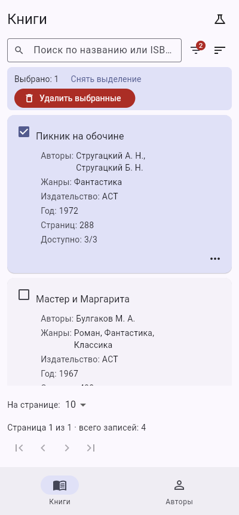
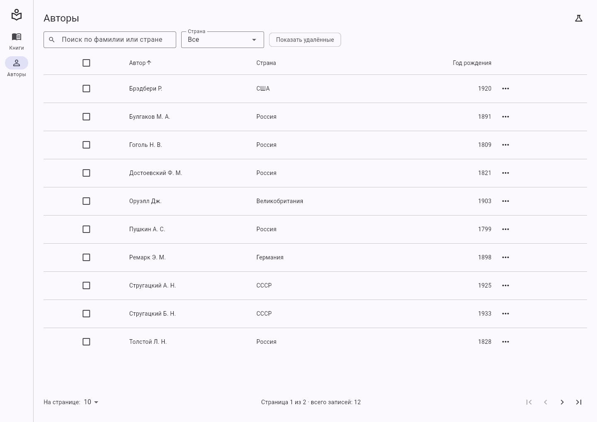

# Библиотека: каталог книг и авторов (Flutter Web)

Практическая работа 2. Списки, поиск, фильтрация и пагинация.

Клиент библиотечной системы на Flutter Web. Реализован каталог: список книг и список авторов с поиском, фильтрами, сортировкой, постраничным выводом, множественным и логическим/физическим удалением. Данные хранятся в памяти и при перезагрузке страницы восстанавливаются из начального набора (36 книг, 12 авторов). Сервер подключается позже, в ПР4: для этого заменяется только репозиторий.

Все условия отбора записываются в адрес, поэтому ссылку на отфильтрованный список можно отправить коллеге:

```
/books?search=война&genreId=2&publisherId=1&yearFrom=1960&sort=year,desc&page=1&size=10
```


## Что реализовано

- **Слои:** `models`, `repositories`, `state`, `screens`, `widgets` (плюс `core` и `data`). Виджеты не обращаются к репозиторию: только через `ChangeNotifier`.
- **Состояние на `provider`:** `setState` используется только для локального состояния (раскрытие панели фильтров на узком окне).
- **Книги и авторы:** модели с `copyWith`, репозитории в памяти (`InMemoryBookRepository`, `InMemoryAuthorRepository`), экраны списка и карточки, переходы через `go_router`.
- **Четыре состояния экрана:** загрузка, успех, пустой результат, ошибка. Пустой результат и ошибка выглядят по-разному.
- **Поиск:** книги по названию и ISBN, авторы по фамилии и стране. Выборка запускается через 400 мс после окончания ввода, а не на каждую клавишу.
- **Фильтры:** жанр, издательство, диапазон года издания (для авторов страна) комбинируются между собой и с поиском.
- **Удаление:** флажки в строках, счётчик выбранного, удаление выбранных с подтверждением. Логическое (`deletedAt`), физическое, показ удалённых и восстановление.
- **Пагинация:** первая, предыдущая, следующая и последняя страницы, номер страницы, общее число записей, размер страницы 10, 25 или 50.
- **Сортировка:** по щелчку на заголовке колонки (книги: название, год, страниц; авторы: ФИО, страна, год рождения), стрелка в активной колонке.
- **Адаптивность:** при ширине окна меньше 600 px вместо таблицы список карточек и нижняя навигация, шире 600 px таблица и боковая полоса.
- **Обобщённая таблица:** `EntityTable<T>` описывается набором `TableColumnSpec<T>` и используется и для книг, и для авторов без копирования кода.
- **Адрес как состояние:** условия списка берутся из адреса и записываются в него. Открытие адреса в новой вкладке восстанавливает то же состояние, кнопка «назад» возвращает к предыдущему набору условий. Некорректные параметры (`page=-4`, `sort=password,desc`) заменяются значениями по умолчанию, номер страницы за пределами списка исправляется на последнюю.
- **Ошибка в `deleteMany`:** найдена и исправлена (см. ниже).

## Параметры адреса

| Параметр | Значение | По умолчанию |
|---|---|---|
| `search` | строка поиска | пусто |
| `genreId`, `publisherId`, `authorId` | число | нет |
| `yearFrom`, `yearTo` | число | нет |
| `country` | страна (только авторы) | нет |
| `sort` | поле и направление: `year,desc` | `title,asc` / `fullName,asc` |
| `page` | номер страницы | 1 |
| `size` | 10, 25 или 50 | 10 |
| `includeDeleted` | `true` | нет |

Значения по умолчанию в адрес не попадают.

## Ошибка в `deleteMany`

В исходном методе проверка записывалась так:

```dart
final i = _books.indexWhere((b) => b.id == id && !b[i].isDeleted);
```

Код не компилируется по двум причинам. Внутри замыкания `b` уже является книгой, а у `Book` нет оператора `[]`. Кроме того, переменная `i` объявляется этой же строкой и используется до того, как получит значение. Нужна проверка `!b.isDeleted`:

```dart
final i = _books.indexWhere((b) => b.id == id && !b.isDeleted);
```

Исправление покрыто тестом: метод не считает уже удалённые и несуществующие записи.

## Проверка состояний «ошибка» и «загрузка»

На данных в памяти ответ приходит мгновенно, поэтому в заголовке списка есть меню «Проверка состояний» (значок колбы): имитация сбоя сервера и замедление ответа на 4 секунды.

## Запуск

```bash
flutter pub get
flutter run -d chrome --web-port=5555
flutter test
flutter analyze
flutter build web
```

## Снимки экранов

| Таблица | Фильтры |
|---|---|
|  |  |

| Выделение строк | Подтверждение удаления |
|---|---|
|  |  |

| Пустой результат | Ошибка |
|---|---|
|  |  |

| Загрузка | Удалённые записи |
|---|---|
|  |  |

Узкое окно (карточки):

| Список | Панель фильтров | Выделение |
|---|---|---|
|  |  |  |

Авторы и карточки записей:

| Авторы | Карточка автора |
|---|---|
|  |  |

## Структура

```
lib/
├── main.dart, app.dart        точка входа, провайдеры, тема
├── core/                      router, breakpoints, debouncer, dev_settings
├── data/seed_data.dart        начальный набор данных
├── models/                    Book, Author, PageResult, запросы (BookQuery, AuthorQuery)
├── repositories/              интерфейсы и реализации в памяти
├── state/                     EntityListNotifier<T, Q>, карточки, справочники
├── screens/                   книги, авторы, карточки, каркас, 404
└── widgets/                   EntityTable<T>, карточки, пагинация, состояния, фильтры
test/                          модели, репозитории, состояние, экраны
```
